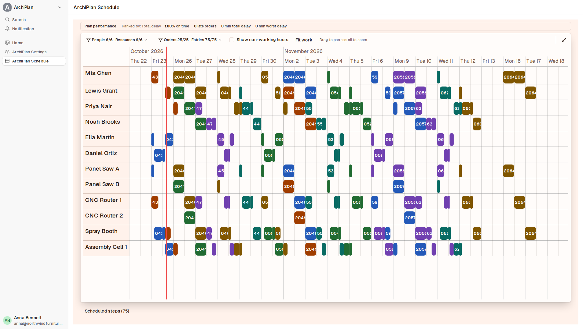
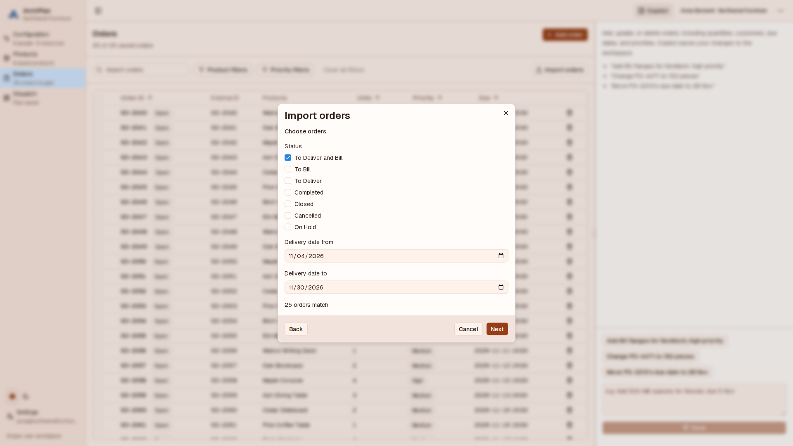
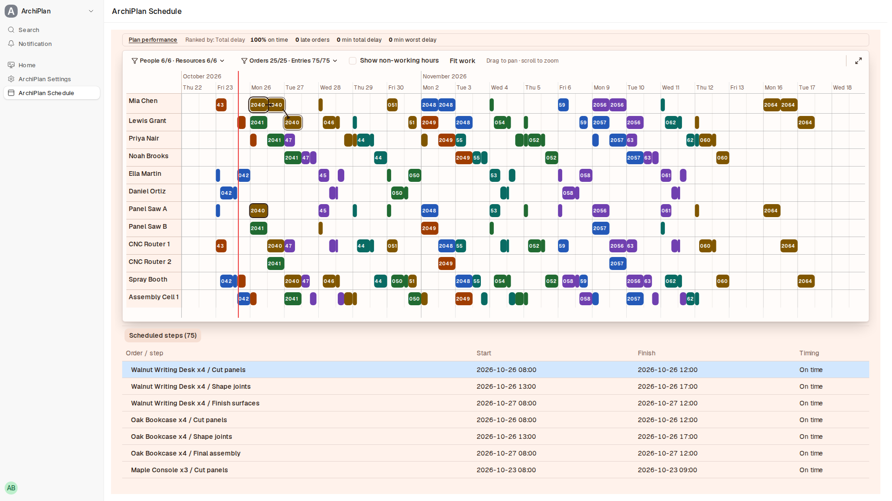
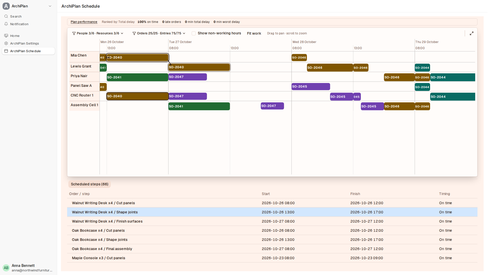
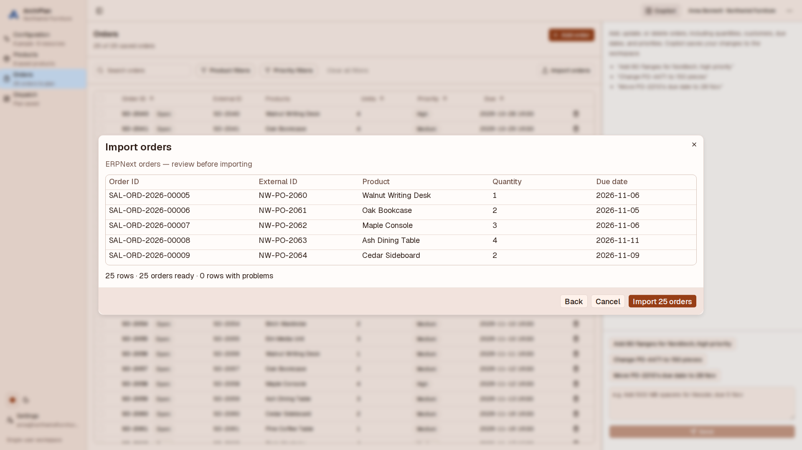
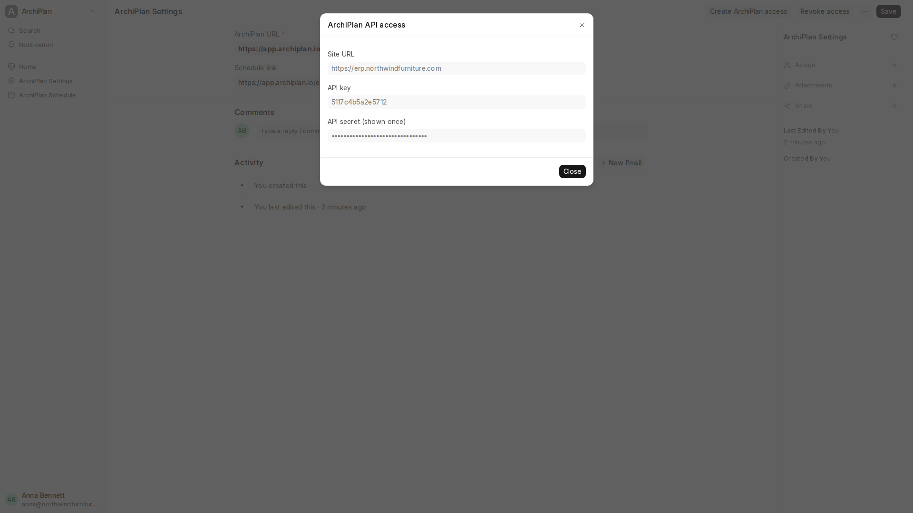
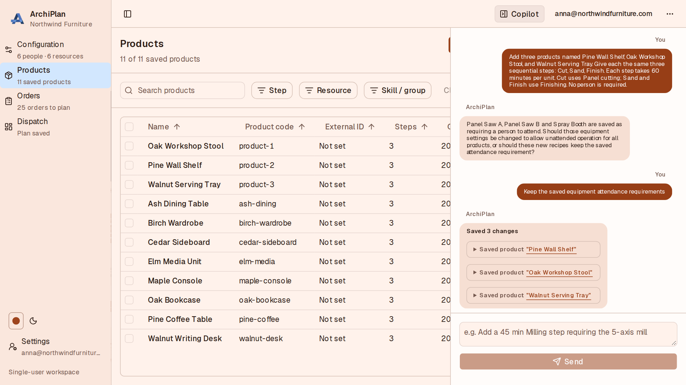
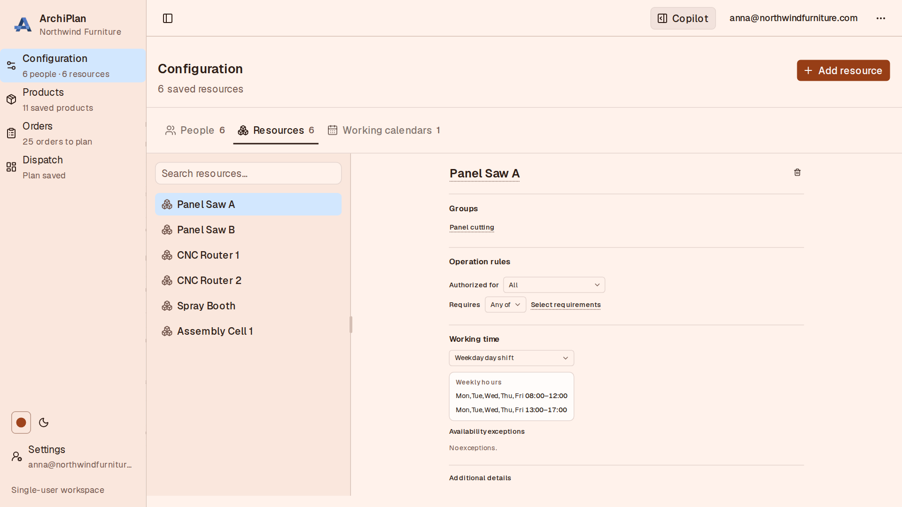

# ArchiPlan for ERPNext

Production scheduling for ERPNext. Plan production on people, machines and
shifts from your Sales Orders, and see the live plan inside your ERPNext desk.

[ArchiPlan](https://archiplan.io) is production scheduling for small and
mid-sized manufacturers. Describe your shop by voice or text, and it plans every
order around your people, machines, shifts and deadlines. When a rush job lands
or someone is off, rebuild the plan in one click.



Supports Frappe and ERPNext version 15 and 16. Needs an ArchiPlan account.

## What the app adds

- **ArchiPlan Settings**: your ArchiPlan URL and the view-only schedule link.
- **Create ArchiPlan access**: creates one ArchiPlan user with read-only access
  to Sales Orders and Items, and shows its Site URL, API key and API secret once.
- **Revoke access**: removes the API keys and disables that user.
- **ArchiPlan Schedule**: a page that shows your live schedule in ERPNext.
- An **ArchiPlan** workspace with links to both.

The ArchiPlan user cannot change anything in ERPNext and cannot read other data
such as customers or employees.

## Install

On Frappe Cloud, add **ArchiPlan** from the Marketplace to your bench and site.

On your own bench:

```bash
bench get-app https://github.com/AutomateLab-tech/archiplan-frappe --branch version-16
bench --site your-site install-app archiplan
```

Use `--branch version-15` for version 15.

## Set up

1. In ERPNext, open **ArchiPlan Settings** and click **Create ArchiPlan access**.
   Copy the Site URL, API key and API secret. The secret is shown only once.
2. In ArchiPlan, open **Orders → Import → From ERPNext** and paste them.
3. Choose Sales Orders by status and delivery date, check the preview, and import.
4. Build the plan in ArchiPlan. Copy its view-only schedule link into
   **ArchiPlan Settings → Schedule link** and save.
5. Open **ArchiPlan Schedule** in ERPNext to see the plan.



## Screenshots

| | |
| --- | --- |
|  |  |
| Follow an order step by step | Zoom in to the hour |
|  |  |
| Check the orders before importing | Read-only ERPNext access |
|  |  |
| Set up by talking | Machine rules and hours |

## Support

Contact us at [archiplan.io](https://archiplan.io/#contact).
[Privacy policy](https://archiplan.io/privacy) ·
[Terms of service](https://archiplan.io/terms)

## License

MIT
